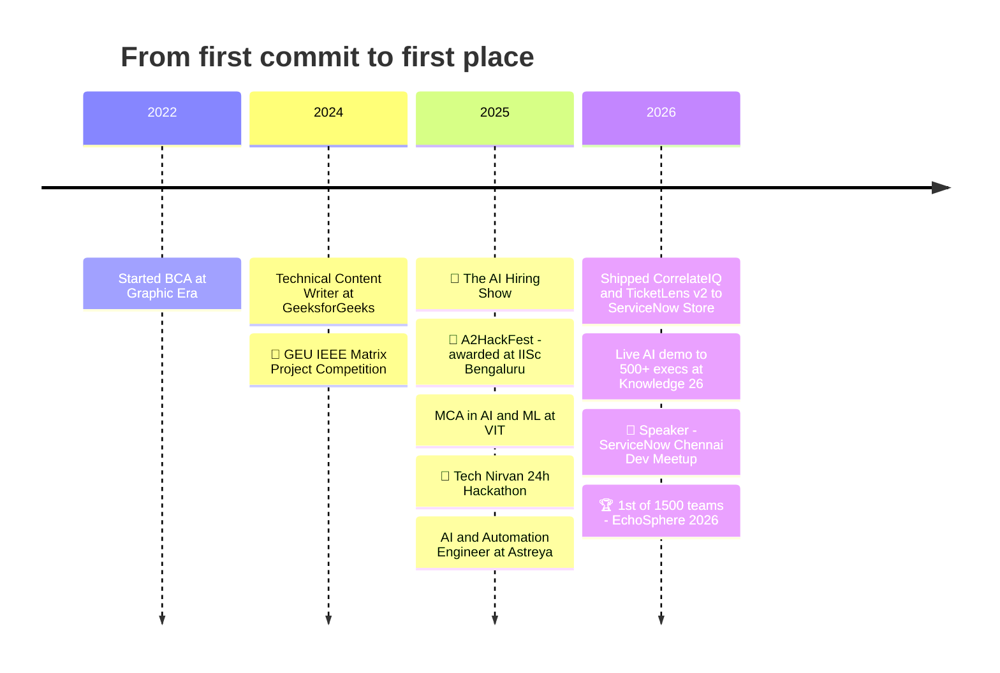

<!-- ═══════════════════════════ HEADER ═══════════════════════════ -->
<p align="center">
  
</p>

<p align="center">
  <a href="https://www.linkedin.com/in/shivam-mahendru-5b212b203/">
    
  </a>
</p>

<p align="center">
  <a href="https://www.linkedin.com/in/shivam-mahendru-5b212b203/"></a>
  <a href="mailto:mahendrushivam123@gmail.com"></a>
  <a href="https://instagram.com/shiiivam_012"></a>
  
</p>

<p align="center">
  
  
  
  
</p>

<!-- ═══════════════════════════ WHOAMI ═══════════════════════════ -->
<h2>⚡ <code>$ whoami</code></h2>

<table>
<tr>
<td width="55%" valign="top">

```python
class ShivamMahendru:
    role      = "AI Engineer"
    based_in  = "India 🇮🇳"
    studying  = "MCA (AI & ML) @ VIT  ·  2025 → 2027"
    previously = [
        "AI & Automation Engineer @ Astreya",
        "Technical Content Writer @ GeeksforGeeks",
    ]
    builds    = ["Voice AI", "Agentic workflows",
                 "ServiceNow apps", "GCP integrations"]
    trophies  = 8          # and counting 🏆
    superpower = "idea → working demo in < 24h"

    def say_hi(self):
        return "Let's build something that wins 🚀"
```

</td>
<td width="45%" valign="top">

🔭 &nbsp;Building **real-time voice agents** with Agora RTC / RTM + Conversational AI<br/>
🛒 &nbsp;Shipped **CorrelateIQ** & **TicketLens v2** to the **ServiceNow Store**<br/>
🎙️ &nbsp;Demoed AI to **500+ ServiceNow execs** at **Knowledge 26**<br/>
🎤 &nbsp;Spoke at the **ServiceNow Chennai Developer Meetup**<br/>
🧠 &nbsp;Deep in **LLMs, agents & automation** for enterprise<br/>
🤝 &nbsp;Open to **hackathon teams & project collabs**<br/>
💬 &nbsp;Ask me about **voice AI, ITSM + AI, rapid prototyping**<br/>

</td>
</tr>
</table>

<!-- ═══════════════════════════ PLAYER CARD ═══════════════════════════ -->
<h2>🎮 Player Card</h2>

```text
╔══════════════════════════════════════════════════════════════╗
║  PLAYER ........ SHIVAM MAHENDRU            CLASS .. AI ENG  ║
║  GUILD ......... VIT · MCA (AI & ML)        REGION .. INDIA  ║
╠══════════════════════════════════════════════════════════════╣
║  > Hackathon wins       ████████████████░░░░░░   8 & rising  ║
║  > Biggest field beaten ██████████████████████   1,500 teams ║
║  > Execs demoed to      ████████████████████░░   500+        ║
║  > Store apps shipped   ████████░░░░░░░░░░░░░░   2           ║
║  > MTTR slashed         ██████████░░░░░░░░░░░░   -35%        ║
║  > Stages taken         ████░░░░░░░░░░░░░░░░░░   1 ↑         ║
╠══════════════════════════════════════════════════════════════╣
║  ACHIEVEMENTS UNLOCKED                                       ║
║  [★] Beat 1,499 teams           [★] Awarded at IISc          ║
║  [★] Demo to 500+ execs         [★] Shipped to ServiceNow    ║
║  [★] Solo podium vs 1,500 teams [★] Win with strangers in 6h ║
╠═══════════════════════════════════════════════════════════════╣
║  CURRENT QUEST ▸ Ship voice agents people actually talk to   ║
╚═══════════════════════════════════════════════════════════════╝
```

<!-- ═══════════════════════════ TROPHY CABINET ═══════════════════════════ -->
<h2>🏆 Trophy Cabinet</h2>

<table>
  <tr>
    <th>🥇</th><th>Event</th><th>Build</th><th>The Flex</th>
  </tr>
  <tr>
    <td align="center">🥇<br/><sub>Sep '26</sub></td>
    <td><b>EchoSphere 2026</b><br/><sub>Agora Conversational AI Hackathon · Microsoft Office, Gurugram</sub></td>
    <td><b>EasyEV AI</b><br/><sub>Agentic voice EV decision room</sub></td>
    <td><b>1st of 6,000+ participants & 1,500 teams</b> — led Team CodeHackers through 4 rounds to the grand finale</td>
  </tr>
  <tr>
    <td align="center">🥇<br/><sub>Oct '25</sub></td>
    <td><b>Tech Nirvan 24h Hackathon</b><br/><sub>GEHU Haldwani</sub></td>
    <td><b>Offline</b><br/><sub>Mini-internet-in-a-box</sub></td>
    <td>Local LLMs, Wikipedia, e-courses, realtime chat & navigation — <b>during network outages</b></td>
  </tr>
  <tr>
    <td align="center">🥈<br/><sub>Sep '25</sub></td>
    <td><b>A2HackFest 2K25</b><br/><sub>qRaptor.ai × AugmentAppz.ai</sub></td>
    <td><b>AI agents</b><br/><sub>on qRaptor</sub></td>
    <td><b>Solo</b> against 1,500+ teams — <b>awarded at IISc Bengaluru</b></td>
  </tr>
  <tr>
    <td align="center">🥇<br/><sub>Aug '25</sub></td>
    <td><b>The AI Hiring Show</b><br/><sub>Rabbitt Learning · SSCBS</sub></td>
    <td><b>Influencer CRM Agent</b><br/><sub>AI agent + dashboard</sub></td>
    <td>Met teammates that morning, <b>won in under 6 hours</b> vs 20+ teams</td>
  </tr>
  <tr>
    <td align="center">🥇<br/><sub>Nov '24</sub></td>
    <td><b>GEU IEEE Matrix</b><br/><sub>Project Competition</sub></td>
    <td><b>Smart Parking</b><br/><sub>Urban parking management</sub></td>
    <td>Second hackathon win <b>in the same month</b></td>
  </tr>
  <tr>
    <td align="center">✨</td>
    <td colspan="3" align="center"><i>…plus more podiums — <b>8 wins and counting</b>. Got a hackathon? <a href="mailto:mahendrushivam123@gmail.com">Let's team up.</a></i></td>
  </tr>
</table>

<!-- ═══════════════════════════ EXPERIENCE ═══════════════════════════ -->
<h2>💼 Where I've Shipped</h2>

<details open>
<summary><b>🤖 AI & Automation Engineer — Astreya</b> &nbsp;·&nbsp; <sub>Nov 2025 – Jun 2026 · Chennai</sub></summary>
<br/>

<p>
  
  
  
  
</p>

- 🛒 **ServiceNow Store apps** — architected & deployed **CorrelateIQ**; built **TicketLens v2**, an AI-powered real-time incident visualizer inside Service Operations Workspace (Next Experience).
- ☁️ **GCP Marketplace app** — event-based trigger bridging enterprise events with Google Apps Script, killing manual integration workarounds.
- 🎙️ **Knowledge 26 AI Showcase** — AI document-analyzer Q&A app on Service Portal, **demoed to 500+ ServiceNow executives** and commended by leadership.
- ⚙️ **ITSM & CSM** — unified SOW agent experience + scalable REST integrations that cut context-switching.

</details>

<details>
<summary><b>✍️ Technical Content Writer — GeeksforGeeks</b> &nbsp;·&nbsp; <sub>Apr 2024 – Oct 2024 · Remote</sub></summary>
<br/>

- Wrote developer-focused articles on **Machine Learning, DBMS and Java** for one of the largest CS learning platforms.

</details>

<!-- ═══════════════════════════ FEATURED BUILDS ═══════════════════════════ -->
<h2>🚀 Featured Builds</h2>

<p align="center">
  <a href="https://github.com/shhhivam12/easyev"></a>
  <a href="https://github.com/shhhivam12/agora-decision-rooms"></a>
</p>
<p align="center">
  <a href="https://github.com/shhhivam12/SNOW-Draw-n-Guess"></a>
  <a href="https://github.com/shhhivam12/swipe-ai-hiring-platform"></a>
</p>

<table>
  <tr>
    <td width="33%" valign="top">
      <h3>🔍 TicketLens v2</h3>
      <sub>ServiceNow Store · Next Experience</sub><br/><br/>
      AI insights that zoom into incidents in real time — faster root cause, <b>35% lower MTTR</b>.
    </td>
    <td width="33%" valign="top">
      <h3>🧩 CorrelateIQ</h3>
      <sub>ServiceNow Store · Service Portal</sub><br/><br/>
      Intelligent correlation for ServiceNow — <i>AI that thinks, IQ that delivers.</i>
    </td>
    <td width="33%" valign="top">
      <h3>📡 Offline</h3>
      <sub>🥇 Tech Nirvan</sub><br/><br/>
      A mini internet in a box: local LLMs, Wikipedia, courses, chat & maps when the network dies.
    </td>
  </tr>
</table>

<!-- ═══════════════════════════ TECH ARSENAL ═══════════════════════════ -->
<h2>🛠️ Tech Arsenal</h2>

<p align="center">
  
</p>

<p align="center">
  
  
  
  
  
  
  
  
</p>

<!-- ═══════════════════════════ JOURNEY ═══════════════════════════ -->
<h2>🗺️ The Build Log</h2>



<!-- ═══════════════════════════ STATS ═══════════════════════════ -->
<h2>📊 GitHub Pulse</h2>

<p align="center">
  
  
</p>

<p align="center">
  
</p>

<p align="center">
  
</p>

<!-- ═══════════════════════════ EDUCATION ═══════════════════════════ -->
<h2>🎓 Education & Certs</h2>

| | Where | What | When |
|:-:|---|---|---|
| 🎓 | **Vellore Institute of Technology** | Master of Computer Applications — AI & ML | 2025 – 2027 |
| 🎓 | **Graphic Era Deemed to be University** | Bachelor of Computer Applications | 2022 – 2025 |
| 📜 | **MongoDB** | MongoDB Overview: Core Concepts and Architecture | Apr 2026 |

<!-- ═══════════════════════════ CTA ═══════════════════════════ -->
<h2>🤝 Let's Build Something</h2>

<p align="center">
  <b>Hackathon teammate? Voice-AI idea? ServiceNow + AI problem?</b><br/>
  My inbox is open — the best collabs start with a "hey, what if…"
</p>

<p align="center">
  <a href="https://www.linkedin.com/in/shivam-mahendru-5b212b203/"></a>
  <a href="mailto:mahendrushivam123@gmail.com"></a>
  <a href="https://instagram.com/shiiivam_012"></a>
</p>

<p align="center">
  
</p>
